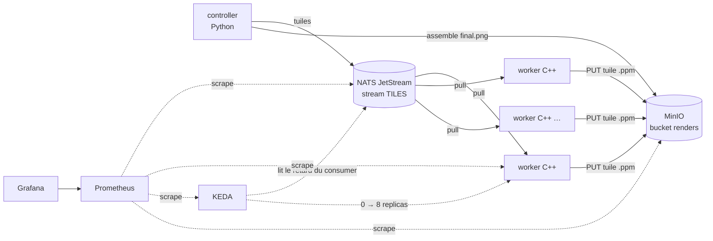

# Render farm

Une petite ferme de rendu distribuée sur Kubernetes (kind). Une image (une fractale de Mandelbrot) est découpée en tuiles. Les tuiles sont distribuées via NATS JetStream à des workers C++, puis stockées dans MinIO et réassemblées en PNG. KEDA ajuste le nombre de workers à la longueur de la file, et Prometheus/Grafana permettent de tout observer.



## Fonctionnement

1. `controller render` découpe l'image en tuiles (64×64 par défaut). Il écrit `jobs/<job>/job.json` dans MinIO, puis publie une tuile par message sur `render.tiles.<job>`.
2. Le stream `TILES` est en mode *work queue*, et tous les workers partagent le consumer durable `workers` : chaque tuile est traitée par un seul worker.
3. Un worker récupère une tuile, la calcule, l'envoie dans MinIO (`jobs/<job>/tiles/<x>_<y>.ppm`, requête S3 signée SigV4 via libcurl), puis acquitte le message. Si l'upload échoue, le message est renvoyé (NAK) et sera retraité, jusqu'à 5 livraisons au total.
4. Le controller attend que toutes les tuiles soient présentes dans MinIO, les colle les unes aux autres et écrit `jobs/<job>/final.png`.
5. KEDA interroge l'endpoint de monitoring NATS (`/jsz`) : à partir de 20 tuiles en attente par worker, il ajoute des replicas (8 au maximum). Une fois la file vide et après 60 s de cooldown, il redescend à 0.

## Prérequis

- Docker, [kind](https://kind.sigs.k8s.io/), kubectl, Helm 3
- curl ≥ 7.75 (pour `--aws-sigv4`, utilisé pour télécharger le résultat)
- Environ 4 Go de RAM libres pour l'ensemble de la stack

## Démarrage

```bash
./scripts/deploy.sh      # crée le cluster si besoin, build les images, installe tout
./scripts/render.sh      # rend une image 1920×1080 et la télécharge dans out/
```

`deploy.sh` est idempotent : on peut le relancer après chaque modification. Il installe les composants dans cet ordre : kube-prometheus-stack (qui fournit les CRD des PodMonitors), NATS, KEDA, MinIO, le job de setup (bucket, stream, consumer), puis les workers et leur ScaledObject.

### Lancer un rendu

Les arguments de `render.sh` sont passés tels quels au controller :

```bash
JOB=zoom ./scripts/render.sh \
    --width 3840 --height 2160 --tile 64 --max-iter 50000 \
    --cx -0.7436447860 --cy 0.1318252536 --scale 0.00003
```

| Option | Défaut | Rôle |
|---|---|---|
| `--width`, `--height` | 1920, 1080 | taille de l'image |
| `--tile` | 64 | côté d'une tuile, en pixels |
| `--max-iter` | 2000 | itérations maximales par pixel (le coût de calcul) |
| `--cx`, `--cy` | -0.7436, 0.1318 | centre de la vue dans le plan complexe |
| `--scale` | 0.003 | largeur de la vue dans le plan complexe (plus petit = plus zoomé) |
| `--timeout` | 600 | délai max d'attente des tuiles, en secondes |

Le job s'appelle `JOB` (par défaut `job-HHMMSS`) ; le résultat est enregistré dans `out/<JOB>.png`.

## Accéder aux interfaces

```bash
kubectl -n monitoring port-forward svc/monitoring-grafana 3000:80
# http://localhost:3000  (admin / render-farm) → dashboard « Render farm »

kubectl -n monitoring port-forward svc/monitoring-kube-prometheus-prometheus 9090
# http://localhost:9090

kubectl -n minio port-forward svc/minio 9001
# http://localhost:9001  (render / render-farm-secret)
```

Pour voir le scaling en direct : `kubectl -n render get deploy render-worker -w` pendant un gros rendu.

## Observabilité

Le dashboard Grafana « Render farm » (`dashboards/render-farm.json`) affiche :

- les tuiles en attente, en cours et redélivrées dans NATS ;
- les replicas désirés (KEDA) et disponibles ;
- le débit de tuiles par worker, les durées p50/p95, le CPU des workers ;
- les pixels rendus par seconde et les requêtes MinIO.

Métriques exposées par le worker sur `:9100/metrics` :

| Métrique | Type |
|---|---|
| `render_tile_seconds` | histogramme : durée du calcul et de l'upload d'une tuile |
| `render_tiles_failed_total` | compteur : tuiles invalides ou dont l'upload a échoué |
| `render_pixels_total` | compteur : pixels rendus |

Prometheus scrape aussi l'exporter NATS (`nats_consumer_*`, `nats_stream_*`), KEDA (`keda_scaler_*`) et MinIO (`minio_*`).

## Arborescence

```
kind-config.yaml          cluster kind : 1 control-plane, 2 workers
worker/                   worker C++ (nats.c, libcurl, nlohmann/json)
controller/               controller Python : setup, submit, assemble, render
k8s/                      manifests : namespaces, MinIO, worker, ScaledObject, monitors
helm/                     values des charts NATS, KEDA et kube-prometheus-stack
dashboards/               dashboard Grafana
scripts/deploy.sh         build et déploiement complet
scripts/render.sh         lance un rendu et télécharge le PNG
```

### Versions épinglées

| Composant | Version |
|---|---|
| Chart NATS | 2.15.1 |
| Chart KEDA | 2.21.0 |
| Chart kube-prometheus-stack | 92.10.1 |
| nats.c | 3.12.0 |
| MinIO | `cgr.dev/chainguard/minio`, épinglé par digest |

Les images officielles `minio/minio` ne sont plus publiées sur Docker Hub, d'où l'utilisation du build Chainguard.

## Dépannage

**`failed to create fsnotify watcher: too many open files`** : la limite inotify de l'hôte est trop basse pour kind (c'est fréquent sous WSL2). `render.sh` contourne le problème, mais `kubectl logs -f` et certains pods peuvent en souffrir. La solution est de relever la limite :

```bash
sudo sysctl fs.inotify.max_user_instances=512
echo 'fs.inotify.max_user_instances=512' | sudo tee /etc/sysctl.d/99-kind.conf
```

**Les workers ne démarrent pas alors que des tuiles attendent** : vérifie `kubectl -n render describe scaledobject render-worker`. KEDA doit pouvoir joindre `nats.nats.svc.cluster.local:8222`, qui est exposé via `service.ports.monitor` dans `helm/nats-values.yaml`.

**Un worker log `subscribe failed` au démarrage** : le stream n'existe pas encore. Le worker réessaie toutes les 2 s jusqu'à la fin du job de setup.

## Nettoyage

```bash
kind delete cluster --name render
```

Les identifiants MinIO et Grafana présents dans le dépôt sont des valeurs de développement : ils ne doivent pas être réutilisés ailleurs.
